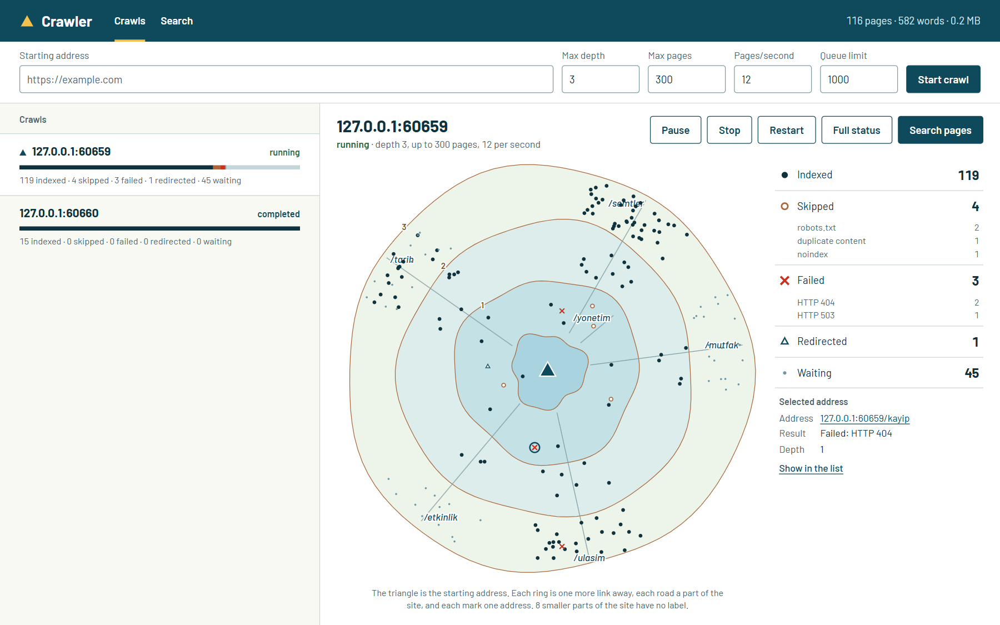
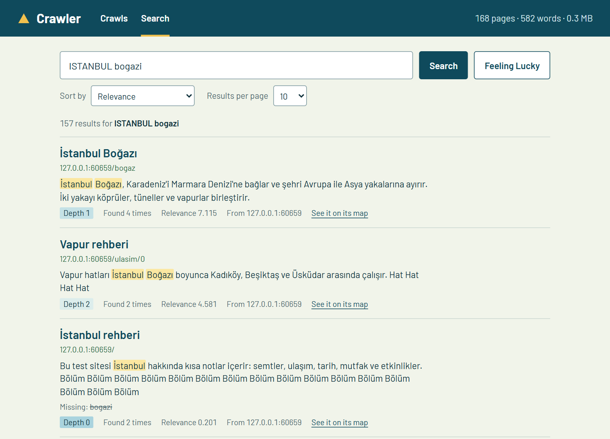
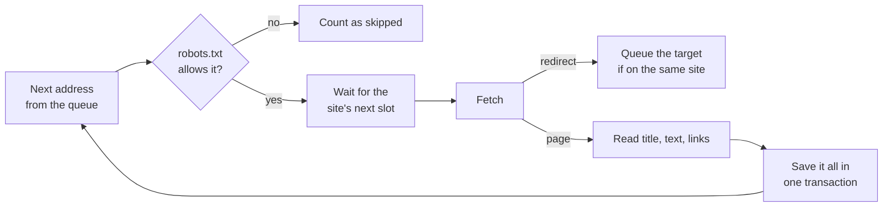

# Crawler

A small search engine that runs on your own machine. Give it a starting address and it crawls that site, respecting robots.txt and a speed limit, then makes every page searchable. The crawler and the search index are written from scratch, with Flask for the web app and SQLite for storage.



*A crawl of a small local test site, in progress. The triangle is the starting address, each ring is one more link away, each road is a part of the site, and each mark is one address.*

## What it does

- **Accounts for every address.** Each one it finishes with is kept with its outcome and reason, such as `robots.txt`, `duplicate content` or `HTTP 404`, and shown on a live map and in a list. Select a mark or a row to see what happened to that address.
- **Runs several crawls at once** with pause, resume, stop and restart. After a crash, an interrupted crawl can be resumed from where it stopped.
- **Searches properly.** Several words at once, ranked with BM25, in any language. Capitals and accents don't matter, and Turkish `İ`, `I`, `ı` and `i` count as one letter.
- **Behaves well on other people's sites.** It obeys robots.txt, `Crawl-delay`, `Retry-After`, `noindex` and `nofollow`, and two jobs on one site share one speed limit.



*The query has no Turkish letters and the results do.*

## Run it

Python 3.10 or newer.

```bash
python -m venv .venv
source .venv/bin/activate      # Windows: .venv\Scripts\activate
pip install -r requirements.txt
python app.py
```

Then open <http://127.0.0.1:3600>. The index is kept in `data/crawler.db`. Set `CRAWLER_PORT` or `CRAWLER_DATA_DIR` to change the port or the folder.

The app only answers on this machine. Be considerate when crawling sites you don't own, and keep the page limit and hit rate low.

## How it works



**The queue and the index share one SQLite database.** Everything a page produces is committed together: its index entry, the new links, the counters and its removal from the queue. So a crash leaves either the whole page or none of it, and jobs can't overwrite each other's work.

**The index** is an inverted index: one row per word per page, with how often the word appears in the body and in the title. Searching looks up each query word and scores the pages with BM25, counting a title occurrence three times. Pages containing more of the query's words come first, and BM25 decides within that.

**Speed limits belong to the site, not the job.** Each site has one next free slot, so more jobs never means more load. A `429` or `Retry-After` holds back every job on that site.

**One page, one result.** Addresses that differ only by http or https, `www`, a trailing slash, tracking parameters or query order count as one. `rel=canonical` and identical content are also recognised.

Each stage has one file to read:

```
app.py                   Pages, JSON API, and the checks on who may call it
config.py                Limits and settings
crawler/crawler_job.py   One crawl: the loop above
crawler/politeness.py    robots.txt and the per-site speed limit
crawler/fetcher.py       Downloading one address, and saying what happened
crawler/parser.py        Title, visible text, links and robots rules from HTML
crawler/url_tools.py     Cleaning addresses and deciding when two are the same
search/index.py          The inverted index, BM25 and snippets
search/tokenizer.py      Turning text into terms in any language
storage/                 The database, job records and each address's outcome
static/crawl_view.js     The map, the legend and the list of addresses
tests/                   Tests, and the local website they crawl
scripts/benchmark.py     The measurements below
```

## Measurements

This started as a course project with a file-based index. These numbers compare that version (commit `e3ed880`) with this one, on the same machine and the same local test site. Concurrent writes are a race, so the old result varied, and both runs are shown.

| | Before | Now |
|---|---|---|
| Index lost with 2 jobs at once | 24.7%, 34.1% | 0% |
| Index lost with 4 jobs at once | 50.4%, 66.9% | 0% |
| Pages not findable by their own word, 4 jobs | 44, 49 of 72 | 0 of 72 |
| Errors reported about that loss | 0 | no loss to report |
| Indexing a page with 300 different words, once 150 pages are indexed | 790 ms, 1210 ms | about 7 ms |

The old times are for the last page indexed, and the new time is an average over the last 50 pages.

As the index grows, indexing does slow down, but far more gently. These are from one run, on Windows 11 with Python 3.13, while other work was running on the machine:

| Pages indexed | Index size | Indexing, per page |
|---|---|---|
| 150 | 2.1 MB | 7 ms |
| 1,000 | 14.4 MB | 22 ms |
| 3,000 | 43.2 MB | 41 ms |

On the 3,000-page index, searching for a rare word took 1.4 ms, and searching for a word on every page took 29 ms.

Reproduce them with `python scripts/benchmark.py`, which takes a few minutes and uses a temporary database.

Behaviour on the same test site:

| Situation | Before | Now |
|---|---|---|
| Searching `machine learning` | 0 results | Found |
| Searching `Türkiye`, `İstanbul`, `müzik` | 0 results | Found, in any spelling |
| Starting address redirects to another host | 1 of 6 pages crawled | 6 of 6 |
| Page forbidden by robots.txt | Fetched and indexed | Never requested |
| `noindex` page | Indexed | Not indexed |
| One page under 4 addresses | 4 results | 1 result |
| Link containing a space or Turkish letter | Not fetched | Fetched |
| `429` from the site | Counted as failed | Waits, retries |
| App restarted during a crawl | Says `running` forever, resume does nothing | Says `interrupted`, resume continues |
| `GET /api/crawlers/..%5C..%5Cx` | Created files outside `data/` | 404, nothing written |
| Another website posting a crawl request | Started a crawl | Refused |
| Search result | Address only, not clickable | Link, title and highlighted snippet |
| Why a page was not indexed | Mixed into one failure count, or lost | A reason for every address, on the map and in the list |

## Tests

```bash
pip install -r requirements-dev.txt
pytest
ruff check .
```

The 370 tests crawl a website that the tests start on this machine, so nothing external is contacted. They include jobs writing at once, a process killed in the middle of a crawl and then resumed, and broken HTML. CI is set up to run them on Linux and Windows with Python 3.10 and 3.13.

## Limits

- **Tested on a local test site only**, not across real websites, where more surprises are certain.
- **No stemming.** `köprü` doesn't find `köprüleri`. Suffixes split off by an apostrophe do work, so `İstanbul` finds `İstanbul'da`.
- **No phrase search.** `machine learning` finds pages with both words anywhere.
- **Languages written without spaces**, such as Chinese or Japanese, are treated as one long word per run of text, so searching part of a run finds nothing.
- **No JavaScript.** Only the HTML the server sends is read, so pages built in the browser look nearly empty.
- **Removed pages stay.** Restarting a crawl updates the pages it finds again, but doesn't remove pages that have since disappeared.
- **Canonical tags are believed.** A site marking every page as canonical for its home page gets one page indexed.
- **A full queue drops links.** Links over `queue_limit` are counted as dropped, and only come back if another page links to them later. Raise the limit if the count isn't 0.
- **Very large crawls.** The map and list show the latest 3,000 addresses, while the counts cover all of them. If a crawl of more than 3,000 addresses is reopened, its roads can be arranged differently from when it was watched, because they are laid in the order parts appear among the addresses shown.
- **One machine, one person.** There are no accounts, it uses Flask's development server, and crawling is one page at a time per job. SQLite handles thousands of pages comfortably here, and it hasn't been measured beyond the numbers above.

[recommendation.md](recommendation.md) covers what growing past these limits would take, and [product_prd.md](product_prd.md) has the detailed behaviour.

## API

| Method | Address | Purpose |
|---|---|---|
| `POST` | `/api/crawlers` | Start a crawl. JSON body: `origin`, and optionally `max_depth`, `max_pages`, `hit_rate`, `queue_limit` |
| `GET` | `/api/crawlers` | List crawls |
| `GET` | `/api/crawlers/<id>` | Status of a crawl |
| `GET` | `/api/crawlers/<id>/wait-status?since_version=&timeout=` | Long polling: answers when the status changes |
| `GET` | `/api/crawlers/<id>/visits?after=` | What happened to each address, the queue, and counts by reason |
| `GET` | `/api/crawlers/<id>/logs?last_n=` | Recent log lines |
| `POST` | `/api/crawlers/<id>/pause`, `resume`, `stop`, `restart` | Control a crawl |
| `GET` | `/search?query=&sortBy=&page=&page_size=` | Search. `sortBy` is `relevance` or `depth` |
| `GET` | `/lucky` | Search for a random indexed word |
| `GET` | `/api/stats` | Totals for the index |

## Changes from the course version

The index moved from `data/storage/*.data` files to SQLite, and old data is not converted, so existing crawls need to be run again. The score formula `frequency × 10 + 1000 − depth × 5` was replaced by BM25, `/search/assignment` was removed, and crawler IDs now end in a random value instead of a thread ID.

## License

[MIT](LICENSE). The Barlow font in `static/fonts` is under the [SIL Open Font License](static/fonts/OFL.txt).
